# Pulse Controller Guide

> **Audience:** exercise controllers who run the simulated media world during an exercise. You know HSEEP,
> MSELs, injects, StartEx and EndEx from Cadence; this guide shows where those things live in Pulse.
> **Applies to:** Pulse as of October 2026.
> **See also:** [Guide home](README.md) · [Getting started](getting-started.md) ·
> [Planner guide](planner-guide.md) · [Participant guide](participant-guide.md) ·
> [Glossary](glossary.md) · [Troubleshooting](troubleshooting.md)

Labels in **bold** are the words you see on screen. Keyboard shortcuts are shown as <kbd>Ctrl</kbd>+<kbd>K</kbd>;
on a Mac, use <kbd>⌘</kbd> wherever this guide says <kbd>Ctrl</kbd>.

---

## 1. Your role and the two worlds

As a controller you run the **simulation cell (SimCell)** for the media environment. You speak for every
simulated account (personas), release scripted content from the run sheet, keep the background chatter at the
right level, moderate, and pause the world when you need to.

### Two worlds that never mix

Pulse has two visual worlds, and they are designed so you can never mistake one for the other.

| | What participants see (the fiction) | What you see (the console) |
|---|---|---|
| Look | A consumer social app in the exercise's own branding | The dark, dense COBRA staff look, like Cadence |
| Content | Posts, replies, profiles, trending hashtags | The same posts **plus** who really sent them, the run sheet, the review queue and the controls |
| Time | **Scenario time only** | Scenario time **and** wall-clock time |

What this means for you:

- **Participants never see who is behind a post.** A post you write as @FairhavenWater looks to them exactly like
  any other @FairhavenWater post. The "SIMCELL - MANUAL" origin line and your call sign appear only in the console.
- **Never show the console to participants.** If you need to see what they see, use **Preview as participant**
  (below), or keep a separate participant device signed in.
- **The console header has a classification line** (`UNCLASSIFIED // FOUO`) and the words **Controller Console**.
  If you can see those, you are looking at the staff world.

### Scenario time and wall-clock time

Every time a participant sees is **scenario time**: the exercise clock, in the exercise's time zone. It starts at
StartEx and stops while the world is frozen.

The console shows both, Cadence-style:

- The staff header shows a **SCENARIO** clock and a **LOCAL** wall clock side by side.
- When you compose a post, the panel shows **SCENARIO**, **WALL·UTC** and **OPERATOR** (your call sign). Only the
  scenario time is stamped on the post.
- The run sheet and Live world show scenario times (Live world names the time zone: **SCENARIO TIME · …**).

> **Tip:** When you brief a time to players or evaluators, use the scenario clock in the header, never your
> watch.

### Preview as participant

To check what participants are seeing without leaving the console:

1. Select **Preview as participant** in the staff header.
2. The console is replaced by a read-only copy of the participant app, labelled
   **PREVIEW AS PARTICIPANT — READ-ONLY**. It shows the exercise's real feed. You can open threads, profiles and
   hashtags, but you cannot post, like or follow from it.
3. Select **Exit preview** to return to the console.

## 2. Signing in and the console tour

### Signing in

1. Open your exercise's staff sign-in page (your planner gives you the address; it ends in `/staff/login`).
2. Enter your **Username** and **Secret**, then select **Sign in**.
3. Pulse opens the **Controller Console** for the exercise you are assigned to.

The exercise is set by the address you sign in at, so there is no exercise field to fill in. To leave, select
**Sign out** in the staff header.

### Picking the active exercise

If you are assigned to **two or more exercises**, an **Active exercise** panel appears above the console:

- The exercise you are working in is marked **ACTIVE** with a check mark.
- Select **Switch to *name* (*role*)** to move to another exercise. The console reloads its personas, run sheet
  and Live world for the new exercise; nothing from the previous exercise stays on screen.

If you have only one assignment the panel does not appear; the exercise name in the header tells you where you are.

> **Important:** The header's exercise name and state pill are the source of truth. Check them before you fire
> anything, especially if you work on several exercises in one day.

### Other staff surfaces

The **PULSE** lockup at the top left opens a menu of the staff surfaces your role can reach. For a controller these
are **Controller Console**, **Exercise Management**, **Participants** and **Exercise Report**. Exercise Management
and Participants are covered in the [Planner guide](planner-guide.md).

### Console tour

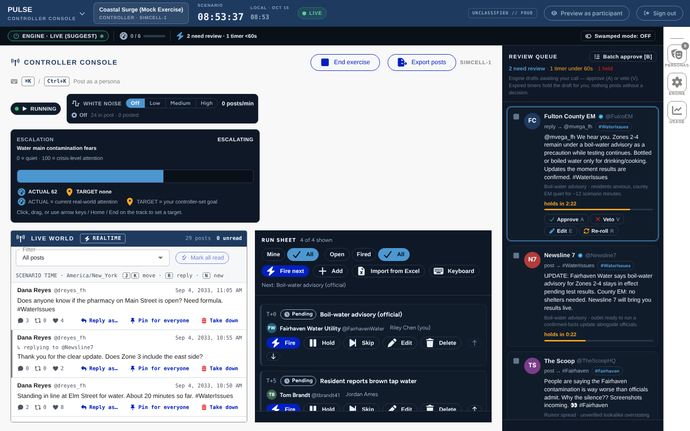

From top to bottom, left to right:

| Area | What it is |
|---|---|
| **Staff header** (navy bar) | Surface menu, exercise name and your role, **SCENARIO** and **LOCAL** clocks, the exercise **state pill**, **Preview as participant**, **Sign out** |
| **Engine bar** | The always-visible engine switch (**ENGINE · LIVE** / **ENGINE · SUGGEST-ONLY** / **ENGINE · STOPPED**), the demand meter, the "need review" count and **Swamped mode** (see [section 10](#10-the-ai-engine)) |
| **Title row** | **CONTROLLER CONSOLE**, **Start exercise** / **End exercise**, **Export posts**, **Exercise report**, your call sign |
| **Shortcut strip** | A reminder: <kbd>⌘K</kbd> / <kbd>Ctrl+K</kbd> **Post as a persona** |
| **Steering row** | The **Pause** pill, the **White noise** control, and the storyline escalation dial |
| **LIVE WORLD** (left column) | Every post in the exercise, newest first, with **Reply as…**, **Pin for everyone** and **Take down** |
| **RUN SHEET** (right column) | Your scripted injects: fire, hold, skip, mark fired, edit, import |
| **REVIEW QUEUE** (far right) | Drafts from the AI engine waiting for your decision |
| **Toolstrip** (right edge) | **PERSONAS** (opens the persona search), **ENGINE** (engine settings), **USAGE** (AI usage), **ADMIN** (participant login triage) |

On screens narrower than about 1280 pixels, Live world and Run sheet stack, with Live world on top.

**Evaluators** can open the same console in a read-only form. They see a **View only** chip, and every control that
changes the exercise is absent. They can still export posts and open the exercise report.

## 3. Before StartEx, starting and ending

### Pre-flight checklist

Walk this list before every StartEx. It takes about ten minutes.

| ✓ | Check | Where |
|---|---|---|
| ☐ | The header shows the **right exercise** and the state pill reads **STAGED** | Staff header |
| ☐ | The personas you need are listed, with the right display names, avatars and verified marks | <kbd>Ctrl</kbd>+<kbd>K</kbd>, then **Edit persona** ([section 11](#11-personas)) |
| ☐ | The run sheet is loaded and in story order; **Assigned to** is set to **All** so nothing is hidden | Run sheet ([section 5](#5-the-run-sheet)) |
| ☐ | If you script in Cadence, the MSEL is imported and the dry run showed no failed rows | Run sheet → **Import from Excel** |
| ☐ | Media the injects need (photos, videos) is in the library | Composer → **From library** |
| ☐ | **White noise** is at the level you want for the opening (often **Off** until StartEx) | Steering row |
| ☐ | The pause tier is what you expect. Many teams rest at **ENGINE PAUSED** before StartEx; it must **never** be **WORLD FROZEN** when players arrive | **Pause** pill |
| ☐ | The **REVIEW QUEUE** is empty (no stale drafts from a rehearsal) | Review queue |
| ☐ | A participant device (or **Preview as participant**) shows the opening feed in scenario time | Preview |
| ☐ | Evaluators know they are view-only and that StartEx/EndEx are controller actions | Briefing |

> **Note:** For a demo or a rehearsal, your Pulse administrator can also run a readiness check and reset the
> demo content between runs. Ask them before the first rehearsal of the day.

### Starting the exercise (StartEx)

1. In the title row, select **Start exercise**.
2. The button reads **Starting…** for a moment. The header state pill changes from **STAGED** to **LIVE** and the
   scenario clock starts.

There is no confirmation step: StartEx is meant to be one deliberate press. There is also no "un-start". If you
start too early, **Pause** the world ([section 9](#9-pausing-and-freezing)) while you recover.

### Ending the exercise (EndEx)

1. Select **End exercise**.
2. In **End the exercise?**, read the exercise name, then type `END` in **Type END to confirm**.
3. Select **End exercise** (the red button). The state pill changes to **ENDEX**.

EndEx cannot be undone from the console. After EndEx the world stops: white noise stops, a Freeze is refused, and
participants see an end-of-exercise page.

### Who can start and end

Only **controllers** see **Start exercise** and **End exercise**. Evaluators and planners do not. Treat StartEx and
EndEx as a controller call made on the exercise director's word, exactly as you would in Cadence.

## 4. Posting as a persona

This is the core controller move: speaking in-character as any account in the world.

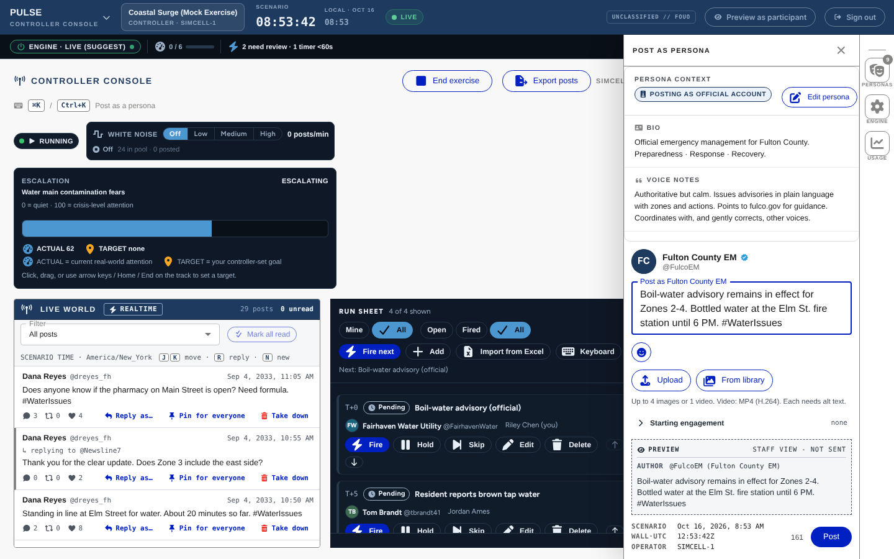

### To post as a persona

1. Press <kbd>Ctrl</kbd>+<kbd>K</kbd> (or select **PERSONAS** on the toolstrip).
2. Type part of a name, handle or type in **Search personas…**. The list groups **Pinned**, **Recent** and
   **All personas**; you can narrow it with **All types** (Agency, News, Citizen, Bad actor and so on).
3. Select the persona. The post panel opens with **PERSONA CONTEXT** (bio, **VOICE NOTES**, audience size and
   **RECENT POSTS**) so you can stay in voice.
4. Write the post in the **Post as *name*** box. The counter shows the characters left (280 maximum).
5. Optional: add media and starting engagement (below).
6. Check the **STAFF VIEW - NOT SENT** preview.
7. Select **Post**, or press <kbd>Ctrl</kbd>+<kbd>Enter</kbd>.

The panel shows **Posted** with the scenario time. The post appears in every participant feed within seconds,
with no refresh, and with no sign that a controller sent it.

> **Tip:** Pin the personas you use most (the pin icon beside each name in the search list) so they sit under
> **Pinned** at the top.

### Adding photos or video

- **Upload** picks files from your computer: up to **4 images or 1 video** per post (video must be MP4, H.264).
  Each upload shows its progress and can be cancelled.
- **From library** opens the exercise's media library: everything already uploaded for this exercise. Filter by
  **Images** or **Videos**, then select a tile. A video keeps its poster image.
- **Every attachment needs alt text.** **Post** stays disabled until each item has it, and a note under the button
  says what is missing.

Anything you upload is added to the library, so you can reuse it later from the run sheet or another post.

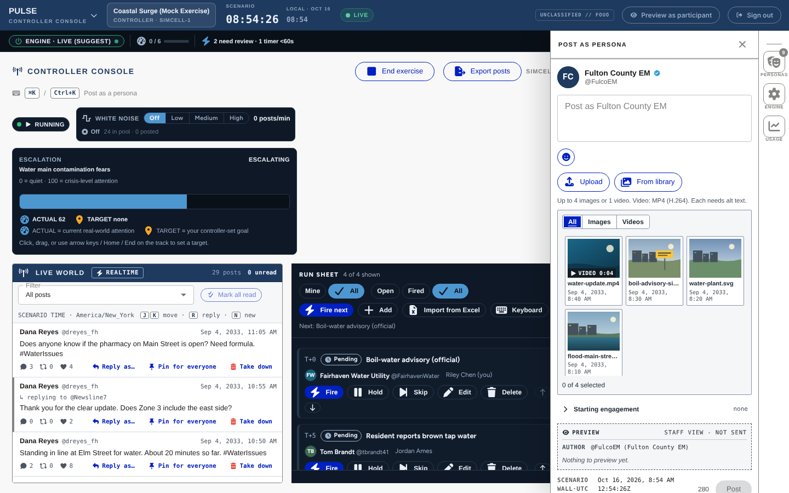

### Starting engagement

Open **Starting engagement** to give a post a head start (for example, a viral rumor that already has 1,800 likes).
Set **Like**, **Repost** and reply numbers, or use a preset. Participants see these numbers plus any real likes and
reposts that follow. Leave it closed for an ordinary post.

### Replying as a persona

1. In **LIVE WORLD**, find the post and select **Reply as…** (or focus the row and press <kbd>R</kbd>).
2. The post panel opens with **Replying to @handle** and a short excerpt of the post.
3. Write and post as usual. The reply lands in the post's thread for participants.

The reply goes out from the persona that is active in the panel. If none is active, the persona search opens first
so you can choose. To clear the reply and post a new top-level post instead, use the **×** beside the
"Replying to" line.

### If something goes wrong

- **A red error banner** means the post was not published. Your draft is kept; fix the problem and post again.
- **Post status unknown** means the connection dropped and the post may already be live. Pulse locks **Post** so
  you cannot double-post. Look at Live world, then choose **I checked the feed - post again** or
  **Discard draft (it went out)**.
- Closing the panel with <kbd>Esc</kbd> or **×** discards the draft.

### Verified accounts and lookalikes (impersonation training)

A verified persona carries the blue verified seal everywhere participants see it. Pulse deliberately lets you run
**unverified lookalikes**: an account such as @FairhavenWaterUpd that copies the real @FairhavenWater's name, banner
and near-identical avatar, but has no seal. That is a training signal: can players tell the official account from
the fake under pressure?

- Post rumors and false guidance from the lookalike; post corrections from the verified original.
- The seal is set per persona in **Edit persona** ([section 11](#11-personas)). Turning it on or off asks you to
  confirm, because participants notice.
- The exercise report has a **verified vs. lookalike** comparison ([section 12](#12-after-the-exercise-export-and-report)).

## 5. The run sheet

The run sheet is Pulse's version of the MSEL conduct view: your scripted social-media injects, in order, with
status chips you can read without relying on color.

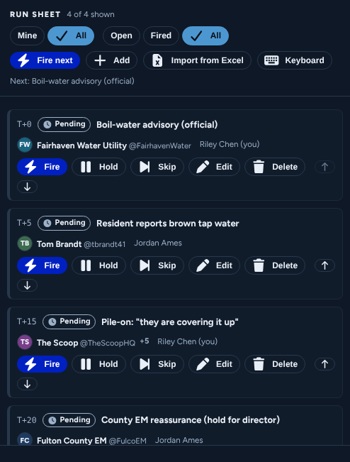

### Reading a row

Each row shows the planned time (**T+N** minutes from StartEx), a status chip, the title, the persona (a burst shows
the first persona and "+N"), the assignee, and, once fired, the scenario time it fired.

| Status | Meaning |
|---|---|
| **Pending** | Ready to fire |
| **Held** | Parked; it will not fire until you release it |
| **Firing** | A burst is going out (for example **Firing 3/8**) |
| **Fired** | Published to participants |
| **Marked fired** | Recorded as delivered, but Pulse posted nothing ([below](#to-mark-an-item-fired-without-posting)) |
| **Skipped** | Not used this run |
| **Failed** | The post was refused; the reason is shown on the row |

> **Important:** Nothing on the run sheet fires on its own. **T+N** is a planning hint, not a timer. Timed
> auto-release of injects is not yet available.

### Filters

- **Assigned to: Mine / All**: show your items or everyone's. Unassigned items appear only under **All**.
- **Status: Open / Fired / All**.

Filters only change what you see; they never lock anything. Pulse remembers your choice for each exercise.

### To fire an inject

1. Select the row (click it, or use <kbd>↑</kbd>/<kbd>↓</kbd>).
2. Select **Fire** (or press <kbd>F</kbd>).

There is no confirmation dialog, by design. The button is disabled while the fire is in flight, so a double press
fires once. To work straight down the script, use **Fire next** (or <kbd>N</kbd>): it fires the first **Pending**
item in the current view and passes over held items. The bar above the list shows **Next: *title***.

A **burst** (pile-on) posts its several posts across its burst window, so you can watch the reaction build in Live
world. Selecting **Hold** while a burst is firing suspends the posts it has not sent yet.

If another controller fires the same item first, you see **Already fired by *name***.

### To hold, release, skip or unskip

- **Hold** (<kbd>H</kbd>) parks a pending item. **Release** (<kbd>H</kbd> again) makes it pending again.
- **Skip** (<kbd>S</kbd>) marks an item as not used this run. **Unskip** brings it back.
- **Retry** appears on a **Failed** item.

### To mark an item fired without posting

Use this when the inject was delivered outside Pulse, or you already posted it by hand from the persona panel and
want the run sheet to show it as done.

1. On a **Pending**, **Held** or **Failed** row, select **Mark fired**.
2. Confirm **Mark as fired without posting? This can't be undone.**
3. The row shows **Marked fired**. Nothing is published.

Mark fired works even while the world is frozen or injects are paused, because nothing reaches participants.

### To add or edit an item

1. Select **Add** (or <kbd>A</kbd>) for a new item, or **Edit** (<kbd>E</kbd>) on an existing one. The editor opens
   in the run sheet, not as a pop-up.
2. Choose the **Item type**: **Single post** or **Burst (pile-on)**.
3. Fill in **Title**, **T+N (minutes)**, **Assignee** and **Notes** (staff-only).
4. For each post choose a **Persona**, write the **Text**, and optionally:
   - **Reply to**: **Not a reply**, a scripted post from an earlier item, or an existing post;
   - media from the **LIBRARY** (upload new media from the persona panel first);
   - **Set engagement baseline** (**Likes**, **Reposts**, **Replies**).
5. For a burst, use **Add post** for each voice and set the **Burst window (seconds)**.
6. Select **Add to run sheet** or **Save changes**.

You can edit **Pending**, **Held** and **Failed** items. **Fired** and **Skipped** items open as
**VIEW ITEM (READ-ONLY)**. **Delete** (with an inline confirm) is offered for pending, held and skipped items. You
can also move items up and down.

If someone else changed the item while you were editing, you see **Changed by someone else. Reloaded.** Re-apply
your change.

### Importing a Cadence MSEL

If you script in Cadence, export the MSEL to Excel and import it. Pulse reads the export as-is and takes only the
social-media rows.

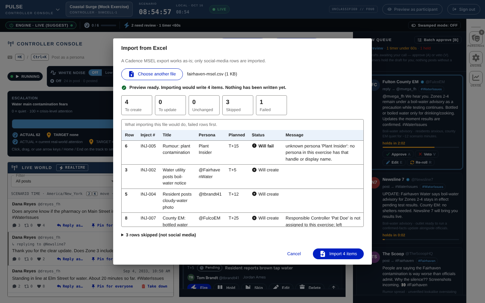

1. In the run sheet, select **Import from Excel**.
2. Select **Choose file** and pick the `.xlsx` (or `.csv`) file in **MSEL file (.xlsx or .csv)**.
3. Select **Preview**. Nothing is written yet. The report lists what would be created, updated, unchanged,
   skipped and failed, failed rows first.
4. Check the failed rows (for example, an unknown persona) and the skipped rows (phone calls, emails and other
   non-social injects are skipped on purpose).
5. Select **Import *N* items**, then **Done**. The new items appear on the run sheet within a few seconds.

How Pulse reads the MSEL:

| MSEL column | Becomes |
|---|---|
| **Delivery Method** | Only rows that say Social Media (or Social, or Pulse) are imported |
| **Inject #** | The item's reference; re-importing the same file updates instead of duplicating |
| **From / Source** | The persona (`@handle` or exact display name in this exercise) |
| **Description** | The post text (280 characters maximum) |
| **Title**, **Notes** | The item title and staff notes |
| **Scenario Day / Scenario Time** | **T+N**, counted from the earliest row (your StartEx row) |
| **Responsible Controller** | The assignee, if it matches a staff name; otherwise the item arrives unassigned |

Pulse also reads optional extra columns for media, alt text and starting engagement; your planner can add them (see
the [Planner guide](planner-guide.md)). Each social row becomes one single post; bursts are built in the console.

Good to know:

- **Re-importing is safe.** Unchanged rows report as unchanged. A changed row updates its item only if the item has
  not fired yet.
- **New items slot in by planned time**, before the first pending item with a later T+N. Fired items never move.
- **Import between beats**, not while a burst is firing. If the run sheet changed during the import, Pulse asks you
  to run it again; nothing was written.

### Keyboard shortcuts

Select **Keyboard** in the run sheet to see this list on screen. Shortcuts are ignored while you are typing in a
field, and every action is also a button.

| Key | Action |
|---|---|
| <kbd>↑</kbd> / <kbd>↓</kbd> | Select the previous / next item |
| <kbd>F</kbd> | Fire the selected item |
| <kbd>N</kbd> | Fire next: the first pending item in this view (held items are skipped) |
| <kbd>H</kbd> | Hold / release the selected item |
| <kbd>S</kbd> | Skip / unskip the selected item |
| <kbd>E</kbd> | Edit the selected item (read-only once it has fired) |
| <kbd>A</kbd> | Add a new item |

## 6. Watching the world

### The Live world column

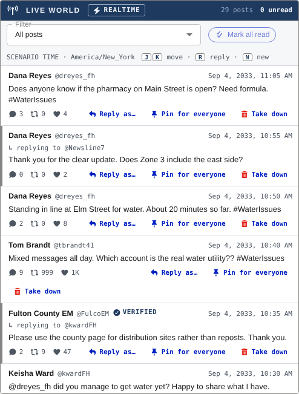

**LIVE WORLD** lists every post in the exercise, newest first, including replies, white noise and engine posts. A
controller must see everything participants can, so a post from an account Pulse cannot name is still listed, as
**UNKNOWN AUTHOR**.

- **Connection status** is shown in the title bar: **REALTIME** (live), **POLLING** (the live connection dropped;
  checking every few seconds) or **CONNECTING**.
- **Unread:** posts that arrive while you watch are bold with a **New** marker until you have seen them. The title
  bar shows **N unread**; **Mark all read** clears them.
- **N new:** while you are scrolled down or working in the list, new posts wait behind an **N new** button instead
  of pushing the list around. Select it (or press <kbd>N</kbd>) to jump to the top.
- **Filter:** **All posts**, a **Hashtag**, or a **Persona**. The active filter shows as a chip you can clear.
- **Engagement:** each row shows the reply, repost and like counts participants see (any starting engagement plus
  real activity). They update live.
- **Edited:** participants can edit their own posts for 15 minutes (up to 5 times). An edited post shows an
  **Edited** chip; select it to see every version with its scenario time. Controllers cannot edit posts.

Keyboard, with focus in the list: <kbd>J</kbd> next (older) post, <kbd>K</kbd> previous (newer) post,
<kbd>R</kbd> **Reply as…**, <kbd>N</kbd> show new posts.

### Pins: for everyone vs. personal

There are two kinds of pin, and only one is yours.

| | **Pin for everyone** (controller) | Personal pin (participant) |
|---|---|---|
| Who sets it | A controller, from Live world | Any participant, on their own feed |
| Who sees it | Every participant: the post shows a **Pinned** marker wherever it appears, and tops their **Pinned** tab | Only that participant |
| Use it for | Official guidance everyone needs, like the newscast "top story" | Their own bookmarks |

To pin a post for everyone:

1. In **LIVE WORLD**, select **Pin for everyone** on the row.
2. The row shows **Pinned for everyone**, and participants see the **Pinned** marker without a refresh.
3. To undo it, select **Unpin**.

Personal pins are private to the participant; they never show in the console or to anyone else.

## 7. Moderation: taking a post down

Take a post down when it contains something that must not stay in the exercise: inappropriate content, personal
information, or a real-world reference that breaks the fiction. You can also take down a fictional post as part of
the storyline (for example, the platform removing the impersonator's rumor).

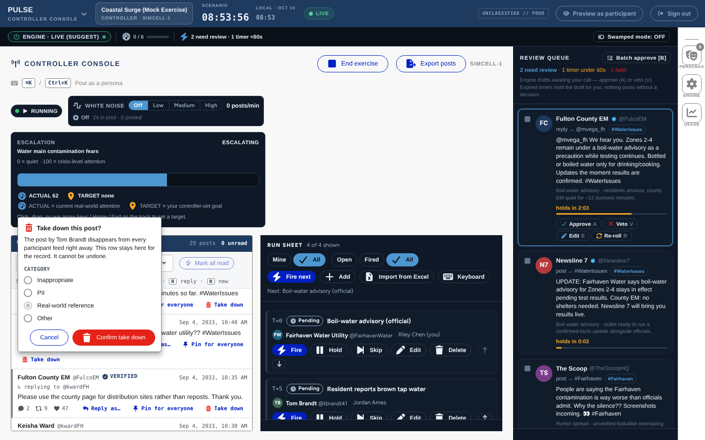

### To take a post down

1. In **LIVE WORLD**, select **Take down** on the row.
2. In **Take this post down?**, choose a **Category**: **Inappropriate**, **PII**, **Real-world reference** or
   **Other** (the default).
3. Select **Confirm take down**.

The row shows **Taken down · *category*** and keeps a **REMOVED** marker. It stays in Live world for the record, and
**Reply as…** is disabled on it.

A takedown cannot be undone.

### What participants see

- The post disappears from open feeds right away, with no refresh.
- Profile and hashtag lists drop it the next time they load.
- A taken-down **reply** shows as **This post is unavailable.** in its thread.
- Participants are not told who removed it or why.

The post stays in the export and the exercise report, marked as taken down with its scenario time.

## 8. White noise (background chatter)

White noise is ordinary, story-neutral chatter from citizen personas: traffic, weather, school, pets. It makes the
feed feel alive and buries the signal the way real social media does. It is not an inject and never appears on the
run sheet.

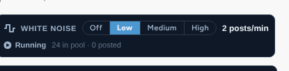

### To set the level

In the steering row, under **White noise**, select **Off**, **Low**, **Medium** or **High** (or use the arrow keys).

| Level | About |
|---|---|
| **Off** | No chatter |
| **Low** | 2 posts a minute |
| **Medium** | 6 posts a minute |
| **High** | 15 posts a minute |

Gaps vary a little so the rhythm feels natural. The control shows the current rate, how many posts are in the pool
and how many have been posted.

The status line tells you why noise is not posting when a level is set, for example **Stopped: the world is frozen**,
**Stopped: the clock is not running**, **Stopped: the exercise has ended** or **No posts in the pool**. Noise
resumes on its own when the cause clears.

> **Note:** **Pause injects** does not stop white noise. To silence the chatter, set it to **Off**. A Freeze stops
> it automatically.

The noise posts themselves (the "pool") are written before the exercise; see the [Planner guide](planner-guide.md).

## 9. Pausing and freezing

The **Pause** pill in the steering row shows the current state in words: **RUNNING**, **INJECTS PAUSED**,
**ENGINE PAUSED** or **WORLD FROZEN**. The header state pill shows the same.

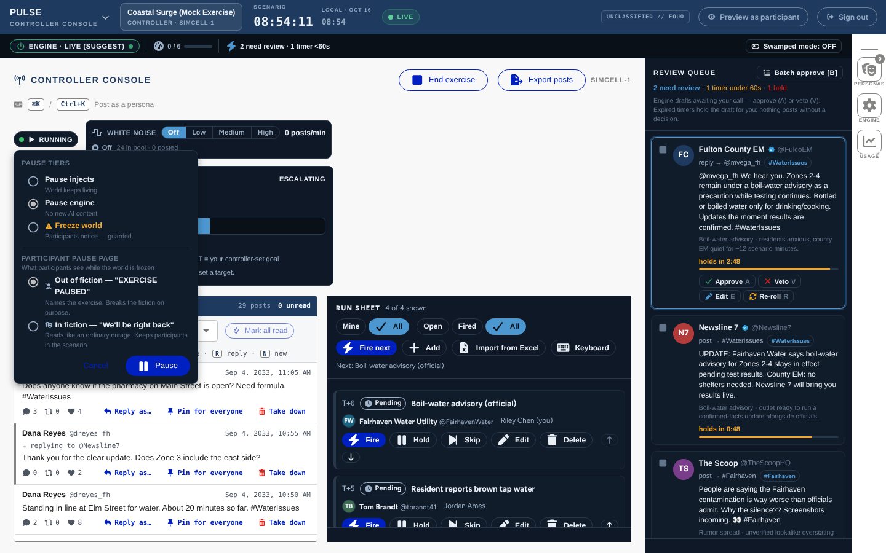

### The three tiers

| Tier | What stops | Scenario clock | What participants see |
|---|---|---|---|
| **Pause injects** ("World keeps living") | Bursts in progress are suspended. Manual **Fire** still works | Keeps running | Nothing changes |
| **Pause engine** ("No new AI content") | The AI engine stops drafting | Keeps running | Nothing changes |
| **Freeze world** ("Participants notice — guarded") | Everything: firing, white noise, the engine and posting | **Stops** | A holding page |

### To pause injects or the engine

1. Select the **Pause** pill.
2. Under **PAUSE TIERS**, choose **Pause injects** or **Pause engine**. (**Pause engine** is pre-selected.)
3. Select **Pause**.

While injects are paused, the run sheet shows **Injects paused: bursts are suspended; manual fire still works**.

### To freeze the world

1. Select the **Pause** pill and choose **Freeze world**.
2. Under **PARTICIPANT PAUSE PAGE**, choose what participants will see:
   - **Out of fiction — "EXERCISE PAUSED"** (the default). Names the exercise and breaks the fiction on purpose. Use
     it when the fiction is already broken, for a safety stop or a real-world issue.
   - **In fiction — "We'll be right back"**. Reads like an ordinary service outage and keeps players in the
     scenario.
3. Select **Pause**. The confirm step **FREEZE THE WORLD?** restates what participants will see.
4. Select **Confirm freeze** (or **Back** to change your mind).

The header reads **WORLD FROZEN**. On the run sheet, **Fire** and **Retry** are disabled with the reason
**World frozen**.

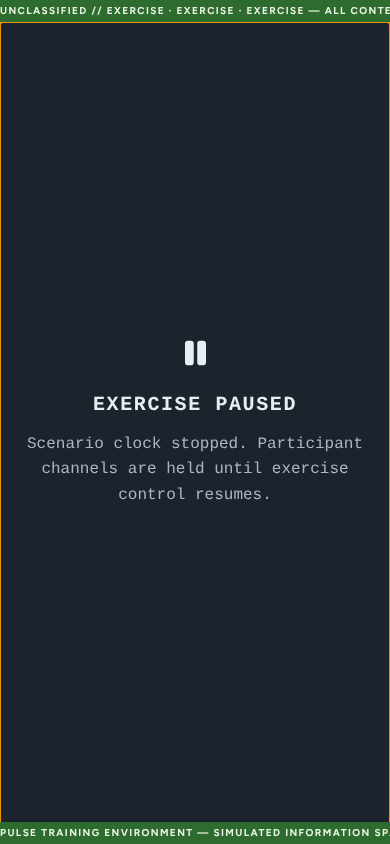

Participants see the holding page at once, without refreshing, and it stays if they refresh.

### To resume

1. Select the **Pause** pill.
2. Select **Resume**.

The holding page clears for participants without a refresh. The scenario clock continues **from the minute it froze**:
frozen time does not count.

### Rules worth knowing

- **Freeze only works in a running exercise.** Before StartEx or after EndEx, Pulse refuses it and shows the reason
  beside the pill. Select **Dismiss** to clear the notice.
- **A server restart does not undo a pause.** If Pulse restarts mid-exercise, the pause tier, the scenario clock and
  the holding page come back exactly as they were. A running clock counts the downtime as elapsed scenario time; a
  frozen clock stays at its frozen minute.
- **The engine settings do not survive a restart.** After a restart, check the engine switch and autonomy
  ([section 10](#10-the-ai-engine)).
- A director-only "break fiction" broadcast to all participants is not yet available. Use **Freeze world** with
  the out-of-fiction page instead.

## 10. The AI engine

Pulse has an optional AI engine that drafts reactions from citizen and media personas when a storyline escalates
(for example, when the official account stays silent too long). **Nothing the engine drafts reaches participants
until a controller approves it.**

> **Important:** In every environment today the engine runs on **Fake**, an offline stand-in that writes canned
> text and calls no AI service. The live AI provider is switched off pending a governance sign-off. Everything in
> this section works the same on Fake; the wording of drafts is just less varied.

### The review queue

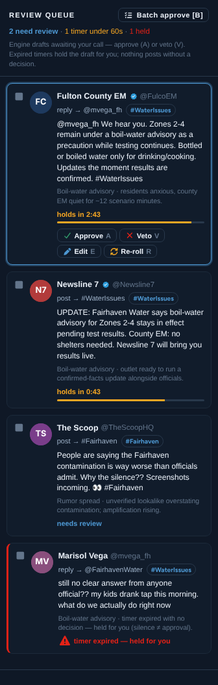

The **REVIEW QUEUE** column holds one card per engine **burst** (a few posts from different personas). Each card
shows the persona, what the draft is (for example "reply → @handle"), the text, the storyline, and its state:
**needs review**, a countdown (**holds in M:SS**), or **timer expired — held for you**. The engine bar shows the
same "need review" count.

For each card:

| Button | Key | Effect |
|---|---|---|
| **Approve** | <kbd>A</kbd> | Publishes the burst under its personas |
| **Veto** | <kbd>V</kbd> | Discards it; nothing is published |
| **Edit** | <kbd>E</kbd> | Opens the draft for rewriting; **Send in-character** publishes your version |
| **Re-roll** | <kbd>R</kbd> | Asks the engine for a fresh draft |

Use <kbd>↑</kbd>/<kbd>↓</kbd> to move between cards and <kbd>Space</kbd> to select several. **Batch approve [B]**
approves the selected cards, or all outstanding ones if none are selected.

### Autonomy: Suggest and Delayed-auto

Open **ENGINE** on the toolstrip to see and change the engine settings.

- **Suggest** (the default): every burst waits in the queue for a decision.
- **Delayed-auto**: each burst shows a countdown. If nobody decides before it ends, the burst is **held, not
  posted** ("timer expired — held for you").
- Fully automatic posting cannot be selected in this version.

**Swamped mode** (in the engine bar) is the only way an undecided burst posts when its countdown ends. Only the
exercise's lead controller can turn it on. While it is on, a **TIMEOUT AUTO-SEND IS ACTIVE** banner stays on screen.
Use it only when the lead decides the cell cannot keep up.

### The engine switch (kill switch)

The switch at the left of the engine bar is always visible. Each click moves it one step:

**ENGINE · LIVE** → **ENGINE · SUGGEST-ONLY** → **ENGINE · STOPPED** → back to **ENGINE · LIVE**.

- **SUGGEST-ONLY** forces every draft to wait for review, whatever the autonomy setting.
- **STOPPED** stops generation at once.
- In the Live position the label also says what is really in effect, for example **ENGINE · LIVE (SUGGEST)**.

If the AI service misbehaves, Pulse drops to Suggest by itself. It never raises autonomy on its own.

### Provider

The **ENGINE** panel shows **RUNNING ON:** and the provider in use. **Cut to Fake** switches the exercise to the
offline generator without a restart; it is greyed out today because the exercise is already on Fake. The **USAGE**
tool shows the provider, model and call counts; select **Refresh** to update it.

### Steering a storyline

The escalation dial in the steering row shows each storyline's actual intensity and phase. Click, drag or use the
arrow keys on the track to set a **TARGET**; the engine moves the storyline toward it while it is in the Escalating
or Peak phase.

> **Note:** The engine settings, the engine switch and Swamped mode reset if the Pulse server restarts. After any
> restart, check the engine bar before you carry on.

## 11. Personas

Personas are the simulated accounts: agencies, news outlets, citizens, bad actors. They are set up before the
exercise by your planner or setup team; there is no "new persona" button in the console.

### To edit a persona's profile

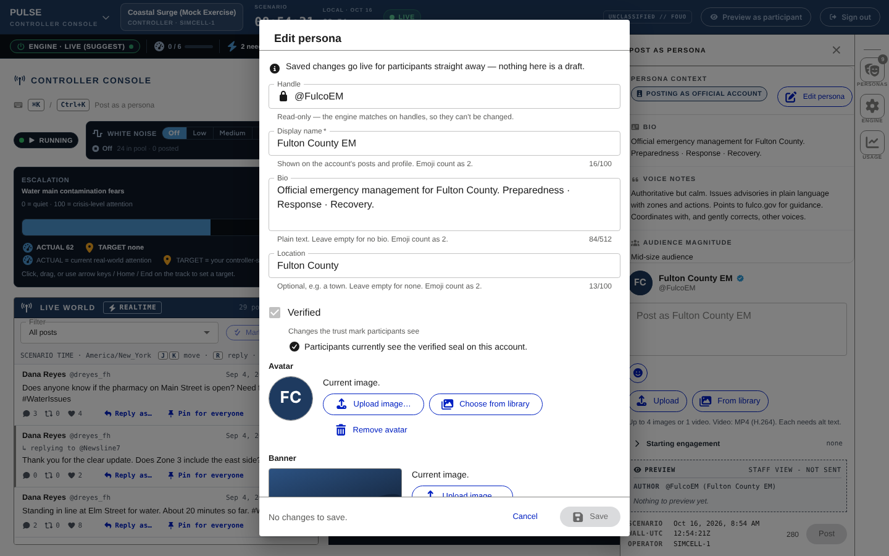

1. Press <kbd>Ctrl</kbd>+<kbd>K</kbd> and select the persona.
2. In the post panel's persona context, select **Edit persona**.
3. Change **Display name**, **Bio**, **Location**, the avatar or the banner (upload a file, or choose one from the
   media library).
4. To change the verified seal, switch **Verified** and confirm **Turn verified ON** or **Turn verified OFF**.
5. Select **Save**. A **Saved** note appears briefly.

The **Handle** is read-only, because the engine and imported MSELs match personas by handle. Changes reach
participants' profiles and posts right away. If you close the dialog with unsaved changes, Pulse asks
**Discard your changes?**; choose **Keep editing** or **Discard changes**.

### The persona list follows the active exercise

The persona search always shows the personas of the exercise you are working in. When you switch exercise, the list
reloads for the new one and any persona you had selected from the old exercise is cleared. You never post as
another exercise's persona by mistake.

## 12. After the exercise: export and report

Both are in the console title row, and evaluators can use them too.

### Export posts (.xlsx)

1. Select **Export posts**. The button shows **Exporting…**.
2. Your browser saves a workbook named like `pulse-posts-<exercise>-<date>.xlsx`.

The **Posts** sheet has one row per post, oldest first, including replies and taken-down posts. Columns include the
scenario time and the UTC wall clock, the author, the **Author type** (Participant, Controller as persona, Scripted
inject, Engine, White noise), who really posted it, the **Inject #**, the shown and real engagement counts, whether it
was pinned for everyone, and its status (**Live** or **Taken down**). The header row is frozen and filtered, so you
can sort and filter straight away (for example, players' posts only).

### Exercise report (Save as PDF)

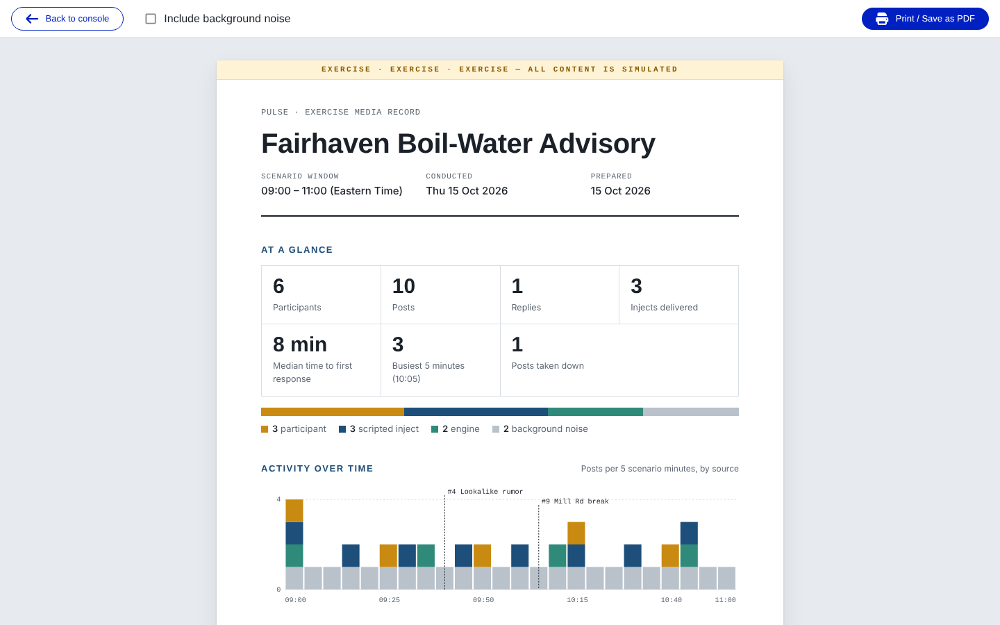

1. Select **Exercise report**. The report opens in the same tab.
2. Optional: tick **Include background noise** to list white-noise posts in the post record. (They are always
   counted in the numbers and the chart.)
3. Select **Print / Save as PDF** and choose **Save as PDF** in your browser's print dialog.
4. Select **Back to console** when you are done.

The report is marked **EXERCISE** at the top and contains:

- **At a glance**: participants, posts, replies, injects delivered, median time to first response, posts edited and
  posts taken down;
- **Activity over time**: posts per interval by source (participant, scripted inject, engine, background noise),
  with inject markers;
- **Inject response times**: for each fired inject, the first participant post that replied to it or mentioned
  its author within 30 scenario minutes (the rule is printed under the table);
- **Verified vs. lookalike**: engagement on each verified account beside its unverified copycat, when the exercise
  had any;
- **The post record**: every post in scenario-time order, grouped by half hour, with images, video posters and
  their alt text.

All times in the report are scenario time. It is a staff document: it shows who really posted each item, so do not
hand it to players during the exercise.

## 13. Quick reference

| Task | Where | How |
|---|---|---|
| Post as a persona | Anywhere in the console | <kbd>Ctrl</kbd>+<kbd>K</kbd> → pick persona → write → **Post** (<kbd>Ctrl</kbd>+<kbd>Enter</kbd>) |
| Reply in-character | Live world row | **Reply as…** (<kbd>R</kbd>) → write → **Post** |
| Attach media | Post panel | **Upload** or **From library**; alt text required |
| Fire an inject | Run sheet | Select row → **Fire** (<kbd>F</kbd>), or **Fire next** (<kbd>N</kbd>) |
| Hold / release | Run sheet | **Hold** / **Release** (<kbd>H</kbd>) |
| Skip | Run sheet | **Skip** / **Unskip** (<kbd>S</kbd>) |
| Record an inject delivered elsewhere | Run sheet | **Mark fired** → confirm |
| Add or edit an inject | Run sheet | **Add** (<kbd>A</kbd>) / **Edit** (<kbd>E</kbd>) |
| Import a Cadence MSEL | Run sheet | **Import from Excel** → **Choose file** → **Preview** → **Import *N* items** |
| Pin a post for all players | Live world row | **Pin for everyone** (undo: **Unpin**) |
| Take a post down | Live world row | **Take down** → category → **Confirm take down** |
| See an edit history | Live world row | **Edited** chip |
| Set background chatter | Steering row | **White noise**: **Off** / **Low** / **Medium** / **High** |
| Pause injects or engine | Steering row | **Pause** pill → tier → **Pause** |
| Freeze the world | Steering row | **Pause** pill → **Freeze world** → page → **Pause** → **Confirm freeze** |
| Resume | Steering row | **Pause** pill → **Resume** |
| Approve / veto engine drafts | Review queue | **Approve** (<kbd>A</kbd>) / **Veto** (<kbd>V</kbd>) / **Edit** (<kbd>E</kbd>) / **Re-roll** (<kbd>R</kbd>) |
| Stop the engine now | Engine bar | Click the engine switch to **ENGINE · STOPPED** |
| Change autonomy | Toolstrip | **ENGINE** → **Suggest** or **Delayed-auto** |
| Edit a persona | Post panel | **Edit persona** → change → **Save** |
| See the participant view | Staff header | **Preview as participant** (back: **Exit preview**) |
| Switch exercise | Above the console | **Active exercise** → **Switch to …** |
| StartEx | Title row | **Start exercise** |
| EndEx | Title row | **End exercise** → type `END` → **End exercise** |
| Export posts | Title row | **Export posts** |
| Printable report | Title row | **Exercise report** → **Print / Save as PDF** |

### Not yet available

- Timed auto-release of injects: every inject is fired by a controller.
- Direct messages between personas and participants.
- A director-only "break fiction" broadcast; use **Freeze world** with the out-of-fiction page.
- Undoing a takedown or a **Mark fired**.
- Creating personas from the console.

If something on screen does not match this guide, see [Troubleshooting](troubleshooting.md).
