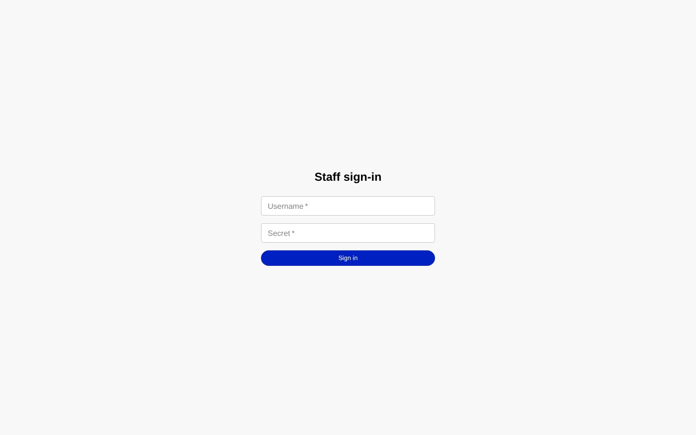

# Getting started

This page explains the ideas behind Pulse and helps you find your way around. Read it once before
you use the other guides.

## What Pulse is

During a real incident, responders work in a noisy information environment. The public posts
rumours, agencies post updates, and lookalike accounts spread false information. Pulse recreates that
environment for an exercise, so that public information officers, EOC staff and leaders can practise
working in it.

Pulse belongs to the Dynamis family of exercise tools, alongside **Cadence**, which builds the MSEL,
and **COBRA**. You can load a Cadence MSEL into Pulse. See
[Importing a Cadence MSEL](planner-guide.md#importing-a-cadence-msel-run-sheet).

A Pulse exercise has two kinds of content:

- **Scripted content.** These are posts you plan in advance, called *injects*. A controller fires
  them at planned times.
- **Live content.** This covers what players post, what controllers post as fictional accounts
  (*personas*), background chatter (*white noise*), and posts drafted by Pulse's AI engine that a
  controller reviews.

## The two worlds

Pulse has two separate sides, and they are kept apart on purpose.

| | Participant world (the fiction) | Staff world (the machine) |
|---|---|---|
| Who sees it | Players | Planners, controllers, evaluators, org admins |
| What it looks like | A familiar consumer social network, branded for your exercise | Dense, plain operator screens in the COBRA style |
| Times shown | Scenario time only | Scenario time and real time |
| Help and instructions | None inside the app | Built into the screens |

**Why players never see help inside the app.** The player side has to feel like the real thing, so
it contains nothing that breaks the fiction: no help pages, no "exercise control" labels and no
real-world clock. The only exercise markings are the banners and watermark you choose in
[Compliance chrome](planner-guide.md#compliance-chrome-banners-and-watermark), which mark the
material as exercise content. Instructions for players therefore come from outside Pulse. Use the
printed or emailed [Participant guide](participant-guide.md), the sign-in cards, and your briefing.

**Why staff screens look so different.** A staff screen should never be mistaken for a player screen,
either in the room or in a screenshot. If a screen looks like an operator console, it is a staff
screen.

## Roles

Each person has a role in each exercise. The same person can be a planner in one exercise and a
controller in another.

| Role | What they can do |
|---|---|
| **Planner** (exercise admin) | Open **Exercise Settings** to configure the exercise: identity, schedule, channels, theming, compliance chrome, practice mode and account import. Open **Participants** to manage the roster, personal links, cards and today's word. Open **Exercise Management** to create exercises and see the organization's exercises. |
| **Org admin** | Open **Exercise Management** to create exercises and see every exercise the organization owns. Org admins do not run or configure an individual exercise. |
| **Controller** | Open the **Controller Console** to run the exercise: start and end it, fire injects, post as personas, review AI drafts, pause or freeze the world, take down posts, export posts and open the **Exercise Report**. Controllers can also open **Participants** and **Exercise Management**. |
| **Evaluator** | Read everything and change nothing. Evaluators see a read-only Controller Console and can open the **Exercise Report**. They also have an **Evaluator Dashboard**, which is *not yet on live data*. |
| **Participant** | Use the exercise's social network: read, post, reply, like, repost and pin. Participants can never reach a staff screen. |

Some participant accounts have the **PIO** role. For now a PIO uses the social network exactly as a
participant does.

**Observers** who only need to read the feed can sign in with the exercise's **View-only code**.
They can read posts but cannot post, reply, like or pin.

## Exercise states

Every exercise moves through these states, in this order. The state appears as a badge on
**Exercise Management** and as a pill in the staff header.

| State | What it means | What players see |
|---|---|---|
| **Build** | You are preparing content. Every new exercise starts here. | Nothing. Players cannot get in. |
| **Staged** | Ready to go. Players can sign in and the background world can run, but the scenario has not started. | The exercise's social network. |
| **Live** | **StartEx** has happened. The scenario clock runs and scripted content fires. | The live exercise. |
| **Paused** | The world is on hold. | A holding page. |
| **Completed** | **EndEx** has happened. The exercise is over. | An end-of-exercise page once they reload; an already-open tab is not updated by itself. Nobody can sign in. |
| **Archived** | Closed out and read-only for staff. This state is final. | Nothing. |

An exercise only moves forward. The one exception is that a paused exercise can go back to Live. A
controller starts and ends the exercise from the Controller Console with **Start exercise** and
**End exercise**. Pausing and freezing are separate controls in the Controller Console. See the
[Controller guide](controller-guide.md).

> **Not yet on a screen:** moving a new exercise from **Build** to **Staged**. Ask Dynamis support to
> stage the exercise once your content is ready.

## Scenario time

Pulse keeps two clocks:

- **Scenario time** is the time inside the exercise story. The scenario clock starts at **StartEx**,
  stops while the world is frozen, and is shown in the exercise's time zone.
- **Real time** (wall-clock time) is the actual time of day.

**Players only ever see scenario time.** Every timestamp on a post, reply or notification is scenario
time. Staff screens show both clocks, labelled, in the staff header.

You set the exercise's time zone under **Exercise Settings > Identity & schedule**. The roster on the
**Participants** screen is the exception: it shows real sign-in times in the exercise time zone, with
the zone named, because staff need real times for troubleshooting.

## Signing in as staff

1. Open the exercise's web address followed by `/staff/login`. Your planner or Dynamis support gives
   you the address. You can also follow **Sign in here** under "Staff or controller?" at the bottom
   of the player sign-in page.
2. Enter your **Username** and **Secret**.
3. Select **Sign in**.

Pulse opens your home screen:

| Role | Home screen |
|---|---|
| Planner | Exercise Settings |
| Controller | Controller Console |
| Evaluator | Evaluator Dashboard |
| Org admin | Exercise Management |

### Signing in to your organization

Staff will soon sign in to their **organization** rather than to one exercise, with their email and
password:

- **With your organization's address** (`console.<platform address>/o/<your organization>`), Pulse
  signs you straight in to that organization. Bookmark it.
- **Without it**, you enter your email and password first. If the same email belongs to you in more than
  one organization, Pulse lists only the organizations where that password is correct, and you choose
  one. The choice lasts two minutes.
- **Org admins** land on **Exercise Management** for the whole organization, even before it has any
  exercises. Everyone else lands on the exercise they used most recently, and switches with the exercise
  switcher. Changing organization means signing in again.
- After five wrong passwords your account is locked for 15 minutes, and the lock grows with further
  failures, up to 4 hours. Every failed sign-in shows the same message, whatever the reason.

#### Setting or resetting your password

If you forget your password, ask your **organization admin** for a reset link. Pulse does not send
email yet, so the admin copies the link and gives it to you directly. Open it and choose a new
password:

- Use at least **12 characters**. There are no rules about numbers or symbols, so a long phrase works
  well. Pulse refuses very common passwords and ones that contain your name, your email or your
  organization's name.
- The link works **once**, for **60 minutes**. If it has expired or was already used, ask for a new one.
- Setting a new password **signs you out everywhere** and cancels any older links.

An org admin cannot get a reset link for another org admin.

> **Not yet on a screen:** the admin's "Reset password" button arrives with the organization directory.
> Until then, Dynamis support issues the link.

> **Not yet on a screen:** the organization sign-in page. Until it arrives, sign in on the exercise's
> address as described above.

### Moving between screens

The top-left corner of every staff screen shows the name of the screen you are on. Select it to open
the screen menu. The menu is grouped into **Plan**, **Conduct**, **Evaluate** and **Administer**, and
it lists only the screens your role can open. The screen you are on is marked **Current**.

The staff header also shows:

- the **scenario clock** and the **real clock**;
- the **exercise state** pill, for example STAGED, LIVE, WORLD FROZEN or ENDEX;
- **Preview as participant**, which shows the real player feed read-only inside your staff screen
  (select **Exit preview** to return);
- **Sign out**.

### Working on more than one exercise

If you are assigned to two or more exercises, an exercise switcher appears above the staff screen.
Use it to choose which exercise you are working on. With only one assignment the switcher does not
appear.

### Good habits for staff sign-in

- **One tab is one staff sign-in.** A staff sign-in lasts only for the browser tab you signed in
  from. A new tab or window asks you to sign in again.
- **Do not open a player link in a staff browser.** Opening a personal sign-in link signs you in as
  that player and signs your staff session out. Test player links in a different browser or a
  private window.
- **Sign out on shared computers.**

If sign-in fails, see [Troubleshooting](troubleshooting.md#staff-cannot-sign-in).

## Your first exercise: the big picture

This is the usual sequence. Each step links to the detailed instructions.

1. **Create the exercise** on **Exercise Management**. It starts in Build.
   [How to](planner-guide.md#creating-an-exercise)
2. **Configure it** on **Exercise Settings**: names, time zone, schedule, channels, look and
   compliance markings. If this is a rehearsal, turn on practice mode.
   [How to](planner-guide.md#exercise-settings)
3. **Build the cast and the script.** Set up personas, then load your Cadence MSEL into the run sheet
   or author injects in the Controller Console.
   [Import an MSEL](planner-guide.md#importing-a-cadence-msel-run-sheet) ·
   [Controller guide](controller-guide.md)
4. **Add players** on **Participants**, either by CSV or one at a time. Each player gets a sign-in
   name, a persona and a personal link. [How to](planner-guide.md#adding-players-to-the-roster)
5. **Get players their sign-in details.** Print cards, email links or copy links, and set today's
   word. Send players the [Participant guide](participant-guide.md).
   [How to](planner-guide.md#getting-players-signed-in)
6. **Check everything** with the [pre-exercise checklist](planner-guide.md#pre-exercise-checklist),
   including **Preview as participant**.
7. **Run the exercise.** The exercise is staged, players sign in, and a controller selects **Start
   exercise**. Controllers drive the world from the console and close out at EndEx: stop
   white noise and the engine, select **End exercise**, then ask players to reload or close their
   tabs. [Controller guide](controller-guide.md#ending-the-exercise-endex)
8. **Close out.** Print the exercise report, export posts, and archive the exercise.
   [How to](planner-guide.md#after-the-exercise)
