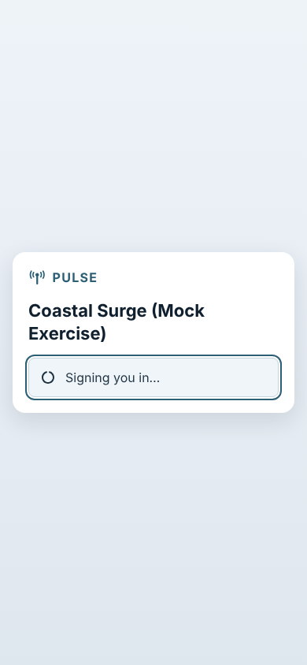
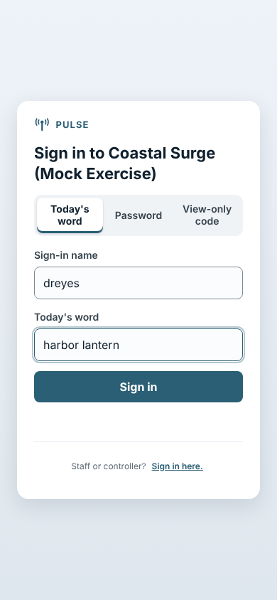
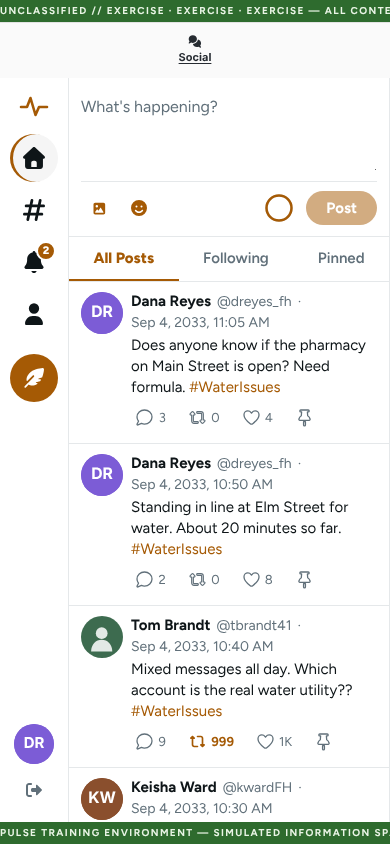
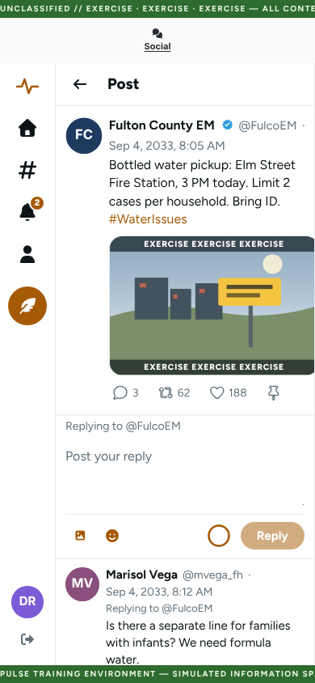
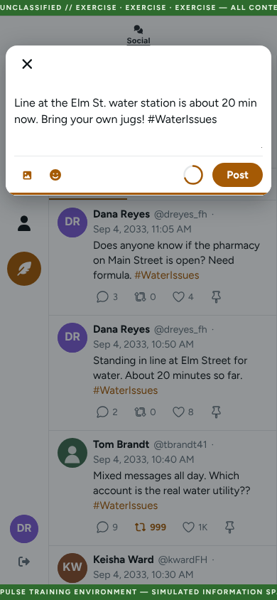
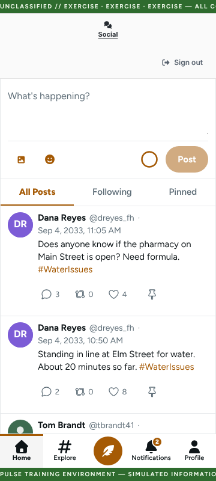
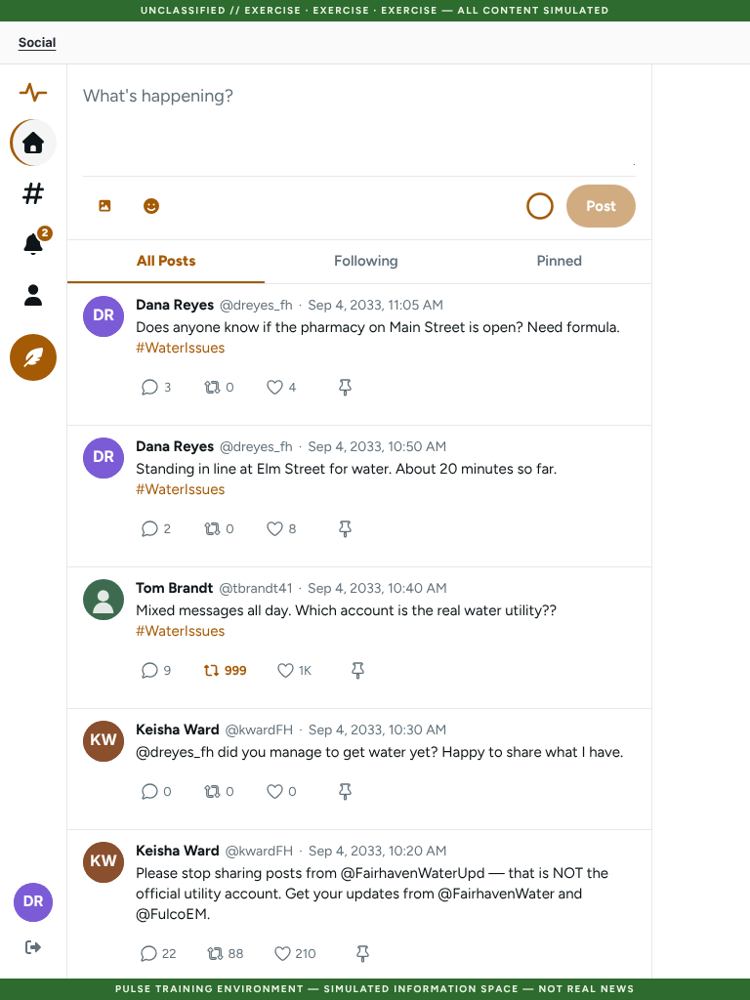
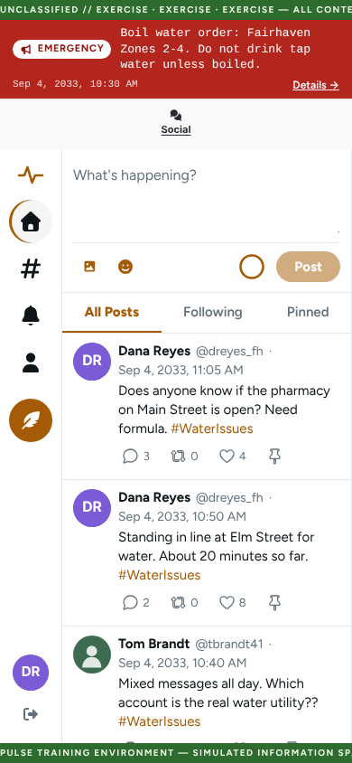
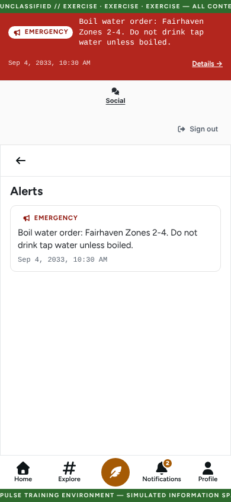

# Welcome to the exercise: how to use Pulse

*For exercise players. Read this before the exercise starts and keep it handy.*

During this exercise you will use **Pulse**, a simulated social network. It works like the social
apps you already know. Everything in it is part of the exercise.

## 1. Join

You will get a personal sign-in card or an email from exercise staff.

- **Tap your personal link**, or **scan the QR code** on your card with your phone's camera.
- You are signed in straight away. There is no password to remember.

Pulse runs in your web browser on a phone, tablet or computer. There is no app to download, but you
can add it to your phone's home screen (see *On a phone or tablet*).

**Your link is personal.** Do not share it or post it. Anyone who has it can sign in as you.

## 2. No link? Sign in with today's word

1. Open the sign-in page. Its address is printed on your card.
2. Select **Today's word**.
3. Type your **Sign-in name** (it is on your card) and **Today's word** (staff will give it to you).
4. Select **Sign in**.

## 3. You stay signed in all day

Once you are signed in, you stay signed in for the rest of the exercise day, even if you close the
tab or lock your phone. If you are on a shared computer, select **Sign out** when you finish.

### Add it to your home screen (optional)

Once you are signed in, you can put the exercise on your phone's home screen so it opens like an app.
You may be offered this automatically; you can always say no.

- **Android (Chrome):** tap **Add [exercise name] to your home screen** on the banner near the bottom
  of the screen, then confirm. If you do not see the banner, open the Chrome menu and choose
  **Add to Home screen** or **Install app**.
- **iPhone or iPad (Safari):** tap the **Share** button (a square with an arrow pointing up) in
  Safari's toolbar, scroll down, choose **Add to Home Screen**, then tap **Add**. The first time you
  open it from the home screen you are signed out (the app does not share Safari's sign-in): choose
  **Sign-in link** and paste the link from your invitation (copy it from Mail or Messages first), or
  choose **Today's word**. On your second visit a short reminder sheet shows these three steps; close
  it with the **X**.

If you close the banner or sheet it will not come back for this exercise.

_Screenshots to follow (Android banner and iOS sheet via mock overrides)._

## 4. What you can do

- **Post.** Write in **What's happening?** and select **Post**. You can add up to 4 photos or a video.
  On a phone, select the picture button to choose from your photo library. Each photo needs a short
  description, and you can remove one with the **X** on its preview. Photos and videos carry an
  **EXERCISE** banner. Tap a photo to see it full screen; **Close** (or the back gesture) returns you
  to the post, and you can pinch to zoom the page.
- **Reply.** Select **Reply** under a post to join the conversation.
- **Like** and **Repost** a post.
- **Pin.** Select **Pin** to save a post to your **Pinned** tab. Posts you like show up there too.
  Some posts are marked **Pinned** for everyone.
- **Edit your own post** within 15 minutes of posting, using **Edit post**. Everyone can see that a
  post was **Edited** and can read its edit history. *(Rolling out. You may not see this yet.)*
- **Follow** accounts, and use **Home**, **Explore**, **Notifications** and **Profile** to find your
  way around (see *On a phone or tablet* below for where they are). A number on **Notifications**
  shows how many you have not read yet.

### On a phone or tablet

Pulse is built for phones first and works in your device's normal web browser (Safari on iPhone and
iPad, Chrome on Android).

- **On a phone**, the buttons along the bottom are how you move around. Tap the round **Post**
  button in the middle to write a post. Buttons are sized for your thumb, so you should not need to
  zoom.
- **On a tablet or computer**, the same buttons are in a column on the left, shown as icons. The
  round feather button writes a post.
- **The EXERCISE banners** at the very top and bottom of the screen always stay visible. Nothing
  you need sits underneath them.
- **In the new-post window**, the **Post** button stays above the keyboard, so you can send without
  closing it.
- **To leave a full-screen photo**, tap **Close**, swipe back, or use your phone's **Back** button.
  You end up back where you were.

**Add it to your home screen (optional).** Once you are signed in, Pulse can sit on your home screen
like an app, under the exercise's name:

- **Android (Chrome):** tap **Add** on the banner that offers to add the exercise to your home
  screen. If you closed the banner, use Chrome's menu (**⋮**) → **Add to Home screen**.
- **iPhone or iPad (Safari):** tap **Share**, then **Add to Home Screen**. When you first open it
  from the home screen you need to sign in again: tapping your link would open Safari, so choose
  **Sign-in link** and paste the link from your invitation, or choose **Today's word**.

Read carefully before you trust or share a post. **Not every account is what it seems.** Lookalike
accounts are part of the exercise.

## 5. Remember: it is all fiction

- **Everything in Pulse is part of the exercise.** That includes the people, the agencies, the news
  and the posts.
- **All times in Pulse are scenario time.** This is the exercise's own clock, not the real time of
  day.
- **Post only in Pulse.** Never copy exercise content to real social media, and never post real
  emergency information in Pulse.
- If a banner or an alert appears across the top of the screen, it is part of the exercise.

Tap **Details →** on the alert bar to read every active alert in full, with the scenario time each
one was issued. Use the back arrow to return to the feed.

## 6. "We'll be right back" or "EXERCISE PAUSED"

If the feed is replaced by a holding page, exercise control has paused the exercise. **This is
normal.** Keep the page open. It usually clears by itself when the exercise resumes; if exercise staff
say the exercise has resumed and you still see it, reload the page. When exercise staff
announce the end of the exercise (EndEx), reload the page or close the tab. Reloading shows an
end-of-exercise page. Until you reload, the feed may stay on screen.

## 7. Need help?

Pulse has no help button, because it is meant to look like the real thing. **Ask exercise staff**:

- In the room: **[name or table, to be filled in by exercise staff]**
- By phone or email: **[contact, to be filled in by exercise staff]**

Common fixes:

- **"This link isn't working any more."** Ask staff for a new link, or sign in with today's word.
- **"That name or word wasn't recognized."** Check your sign-in name and today's word with staff.
- **"Too many tries."** Wait a minute, then try again.
- **"Reconnecting…"** Your connection dropped, but you are still signed in. Select **Try again**.
