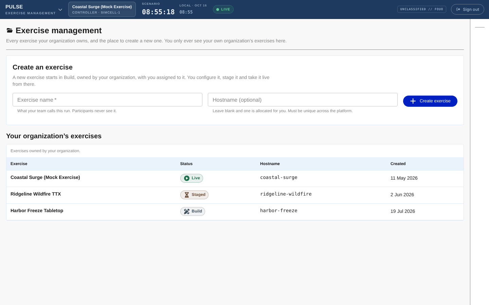
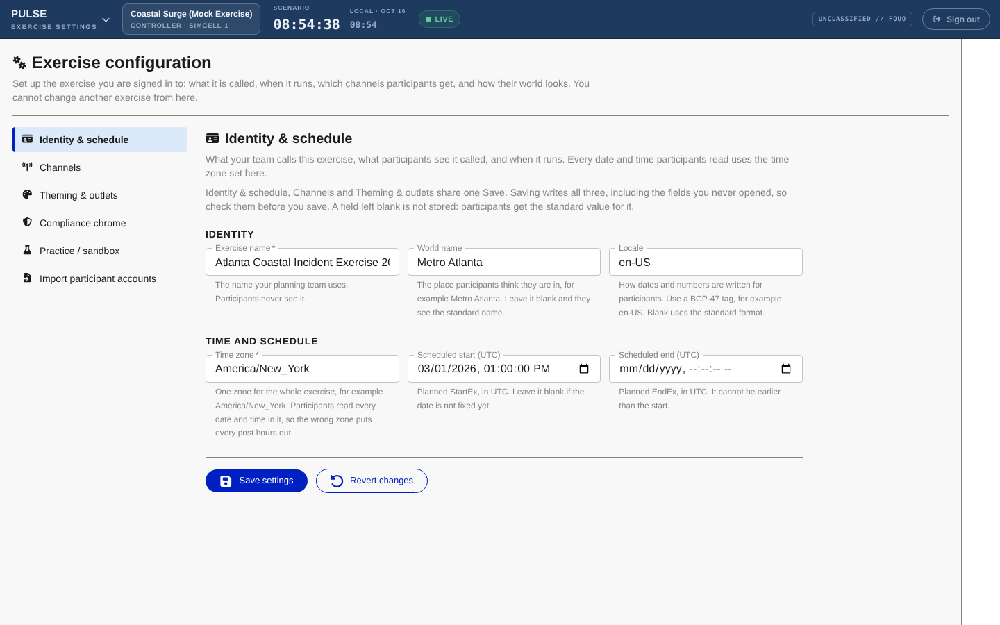
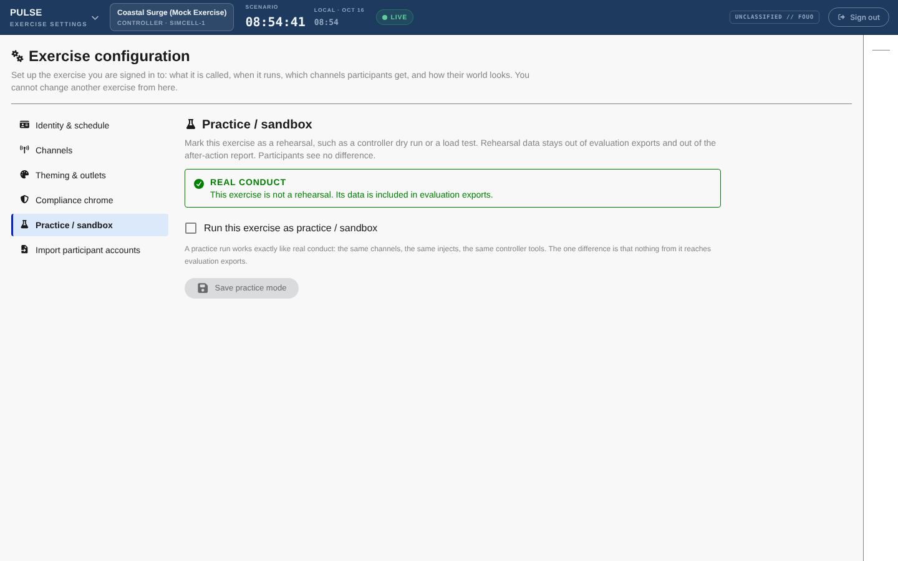
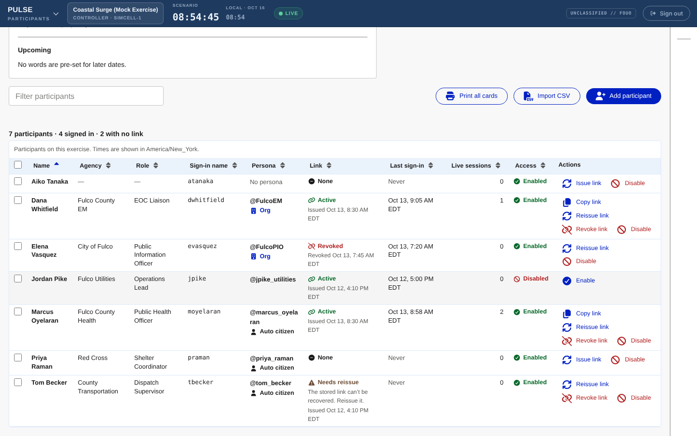
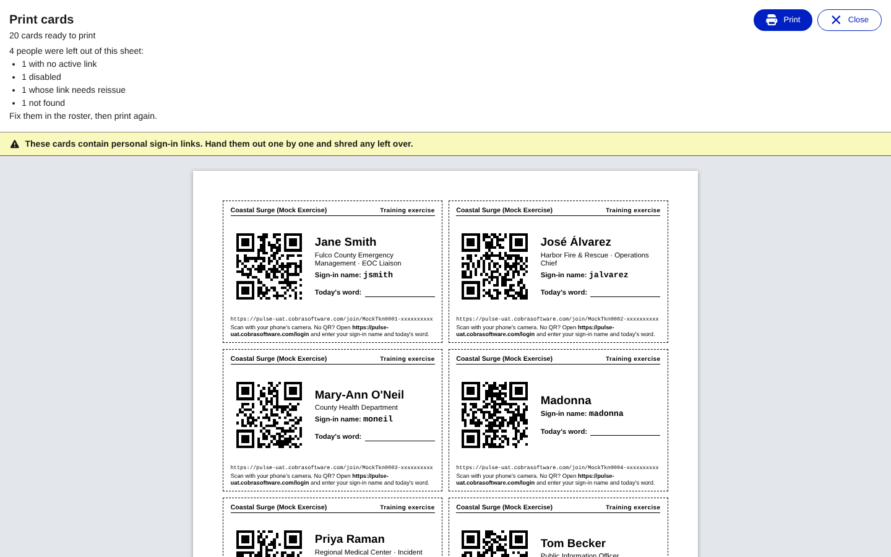
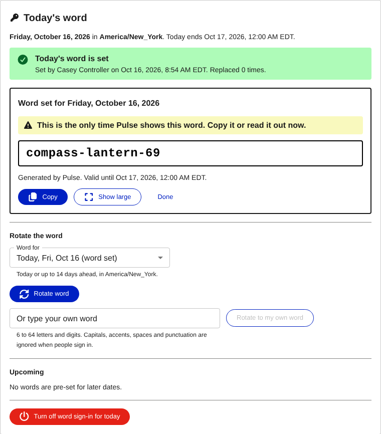

# Planner guide

This guide is for **planners** (exercise admins). It covers setting up an exercise, bringing players
into it, and closing it out. Many of these tasks are also open to other roles:

| Screen | Who can open it |
|---|---|
| **Exercise Management** | Planners, org admins and controllers |
| **Exercise Settings** | Planners |
| **Participants** | Planners and controllers |
| **Controller Console** (where the run sheet and MSEL import are) | Controllers. Evaluators get a read-only view. |

Open any of these from the screen menu in the top-left corner of a staff screen. If you have not
signed in before, start with [Getting started](getting-started.md#signing-in-as-staff).

**On this page**

- [Exercise Management](#exercise-management)
- [Exercise settings](#exercise-settings)
- [Practice mode](#practice-mode)
- [Staff assignment](#staff-assignment)
- [Adding players to the roster](#adding-players-to-the-roster)
- [Getting players signed in](#getting-players-signed-in)
- [Managing personal links and access](#managing-personal-links-and-access)
- [Importing a Cadence MSEL (run sheet)](#importing-a-cadence-msel-run-sheet)
- [Pre-exercise checklist](#pre-exercise-checklist)
- [After the exercise](#after-the-exercise)

---

## Exercise Management

**Exercise Management** lists every exercise your organization owns and is where you create new
ones. You only ever see your own organization's exercises.

The table shows each exercise's **Exercise** name, **Status** (its [exercise
state](getting-started.md#exercise-states)), **Hostname** and **Created** date.

### Creating an exercise

1. Open **Exercise Management**.
2. In **Exercise name**, enter the name your team will use, for example "Harbor Freeze Tabletop".
   Players never see this name. You set the name players see later, as the *world name*.
3. Leave **Hostname (optional)** blank unless Dynamis support has given you a specific web address
   for this exercise. When it is blank, Pulse allocates a hostname for you. A hostname must be
   unique across the whole platform. If yours is taken, Pulse says so under the field and keeps
   everything you typed.
4. Select **Create exercise**.

The new exercise starts in **Build**, and Pulse assigns it to you straight away. To work on it,
choose it in the exercise switcher above the staff screen. See
[Working on more than one exercise](getting-started.md#working-on-more-than-one-exercise).

### Renaming an exercise

> **Rolling out:** renaming and archiving from the table arrive in the current update. If your table
> has no **Actions** column, use **Exercise Settings > Identity & schedule > Exercise name** to rename
> the exercise you are signed in to.

1. Open **Exercise Management**.
2. In the exercise's row, select **Rename**.
3. Enter the new **Exercise name** and select **Rename**.

### Archiving an exercise

Archiving closes out an exercise that has ended. Archived is final: an archived exercise cannot be
reopened. It stays in the list, labelled **Archived**, below the others.

1. Make sure the exercise is **Completed**, which means a controller has selected **End exercise**.
   For any other state, the **Archive** button is unavailable and the row reads "End the exercise
   first".
2. In the exercise's row, select **Archive**.
3. In **Archive the exercise?**, select **Archive**.

> **Not yet available:** duplicating an exercise, and deleting an exercise.

---

## Exercise settings

**Exercise Settings** is the planner's home screen. The page is headed **Exercise configuration**.
It changes only the exercise you are signed in to. To change another exercise, switch to it first.

The section list on the left has six sections:

| Section | What it controls |
|---|---|
| **Identity & schedule** | Names, locale, time zone and the planned start and end |
| **Channels** | Which channels players can use |
| **Theming & outlets** | The brand and colours players see, and the outlet names |
| **Compliance chrome** | Exercise banners and the EXERCISE watermark |
| **Practice / sandbox** | Whether this exercise is a rehearsal |
| **Import participant accounts** | The older account import (see [below](#importing-participant-accounts-older-method)) |

### Identity & schedule, Channels, and Theming & outlets

These three sections share one form, with one **Save settings** button and one **Revert changes**
button. You can move between the three sections before you save and nothing is lost. If you leave
the form with unsaved changes, the section list shows a notice.

1. Select **Identity & schedule** and fill in:
   - **Exercise name**: what your planning team calls the exercise. Players never see it.
   - **World name**: the place players think they are in, for example "Metro Atlanta".
   - **Locale**: how dates and numbers are written for players, for example `en-US`.
   - **Time zone**: one zone for the whole exercise, written like `America/New_York`. Every date and
     time players read uses this zone. Names such as "Eastern Standard Time" are not accepted.
   - **Scheduled start (UTC)** and **Scheduled end (UTC)**: the planned StartEx and EndEx. Leave them
     blank if the dates are not fixed. These are planning dates only. They do not start or end the
     exercise.
2. Select **Channels**. Under **Enabled channels**, tick the channels players can use. At least one
   must be on. *Only the social network is available today.*
3. Select **Theming & outlets** and set:
   - **Brand name**: the name players see across every channel.
   - **Primary color**, **Accent color**, **Surface color** and **On-surface color**: hex values such
     as `#2b5f75`. Leave any of them blank to use the standard colour.
   - The **outlet name** for each channel.
4. Select **Save settings**.

If a value is wrong, Pulse saves nothing. It marks every section that needs a fix with "Needs
attention" and takes you to the first one.

### Compliance chrome (banners and watermark)

Compliance chrome is the set of markings that identifies everything on a player's screen as exercise
material. These markings are the only exercise wording in the player world.

1. Select **Compliance chrome**.
2. Under **Exercise markings**, choose one or both:
   - **Show the compliance chrome banners**: bands across the top and bottom of every player screen.
   - **Show the in-content EXERCISE watermark**: an EXERCISE marking on media inside posts.

   You can turn one of them off, but not both. Every exercise has to carry at least one EXERCISE
   marking, so that a screenshot taken out of context is still marked.
3. If the banners are on, set the **Top banner text** and **Bottom banner text** and their colours.
   Leave a field blank to use the standard wording or colour.
4. Select **Save compliance chrome**.

This section saves on its own. Its **Revert changes** button only affects this section.

---

## Practice mode

Use practice mode for a rehearsal, such as a controller dry run or a load test. A practice exercise's
data is left out of evaluation exports, so it never mixes into the after-action record of a real
exercise.

1. Select **Practice / sandbox**.
2. Tick or clear **Run this exercise as practice / sandbox**.
3. Select **Save practice mode**.

The panel shows the saved state in words:

- **Practice / sandbox**: "This exercise is a rehearsal. Its data is excluded from evaluation
  exports."
- **Real conduct**: "This exercise is not a rehearsal. Its data is included in evaluation exports."

Players never see whether an exercise is in practice mode.

---

## Staff assignment

When you create an exercise, Pulse assigns you to it. Your role on the new exercise is the role you
had when you created it.

> **Not yet available:** adding other staff to an exercise, or changing someone's role, from a
> screen. Ask Dynamis support to set up staff accounts and assignments.

---

## Adding players to the roster

The **Participants** screen is where you manage everyone who can sign in to this exercise as a
player. Each person on it has three things:

- a **sign-in name**, which is what they type to sign in;
- a **persona**, which is the account they post as;
- a **personal link**, which signs them in when they tap it.

The roster table shows **Name**, **Agency**, **Role**, **Sign-in name**, **Persona**, **Link**, **Last
sign-in**, **Live sessions** and **Access**. **Role** is a job title such as "EOC Liaison". It is not
a permission. Use **Filter participants** to search by name, agency or sign-in name.

### How personas are assigned

- **Most players get a citizen persona.** Leave the persona handle blank and Pulse creates one named
  after them, such as `@jane_smith`. The roster marks it **Auto citizen**.
- **A player can operate an organization persona.** Enter the handle of an organization persona that
  already exists in this exercise, such as `FulcoEM`. The roster marks it **Org**. Create organization
  personas in the Controller Console first. See the [Controller guide](controller-guide.md).

A persona handle is public and a sign-in name is private, so the two are never the same. For example,
Madonna signs in as `madonna` and posts as `@madonna_2`.

### To add one person

1. Open **Participants**.
2. Select **Add participant**.
3. Enter the person's **Name**. This is the only required field.
4. Optionally fill in **Agency**, **Role**, **Email**, **Persona handle** and **Sign-in name**:
   - Leave **Sign-in name** blank and Pulse makes one from the name, so Jane Smith becomes `jsmith`.
   - **Email** is for staff only. Players never see it. You need it if you want to email links.
5. Select **Add participant**.

Pulse confirms with "Added *name*. Their sign-in name is *sign-in name*."

### To add many people from a CSV file

1. Open **Participants** and select **Import CSV**.
2. Select **Download template** to get a CSV with the right columns:
   `name,agency,role,email,personaHandle,signInName`. Only `name` is required.
3. Fill in one person per line and save the file as plain CSV, up to 1 MB. A line break inside a cell
   is not supported.
4. Choose the file and select **Validate**. Pulse shows, row by row, what an import would do, and
   changes nothing. Each row reads **Would create**, **Would update**, **Unchanged** or **Failed**,
   with a message.
5. Fix any **Failed** rows in your file and validate again.
6. Select **Import**.

**Uploading again is safe.** Pulse matches each row to people already on the roster, first by sign-in
name, then by email, then by name plus agency. A match updates that person and never creates a
duplicate. A blank cell never erases what is already stored. To correct someone's details or change
their organization persona, fix their row and import the file again. Open **How the file is read**
on the import panel for the full matching rules.

### Importing participant accounts (older method)

**Exercise Settings > Import participant accounts** is an older way to create named accounts that
sign in with a handle and a password. Its CSV needs the columns `username`, `displayName`, `role`
(`participant` or `pio`) and an optional `password`. To import, select **Choose CSV file** and then
**Import accounts**.

**Use the Participants screen for new exercises.** It gives each person a personal link, a card and
today's word, which are much easier for players.

---

## Getting players signed in

Players can sign in three ways:

| Way | How it works | Best for |
|---|---|---|
| **Personal link or QR code** | The player taps their own link or scans the QR code on their card, and is signed in. Nothing to type. | Everyone. This is the main way. |
| **Today's word** | On the sign-in page, the player types their **Sign-in name** and **Today's word**. | Anyone who lost their card or link, or is on a new device. |
| **View-only code** | A shared code for observers. They can read the feed but cannot post. | Observers and visitors. |

Once signed in, a player **stays signed in for the rest of the exercise day**, even if they close the
tab or lock their phone. Their sign-in ends at midnight in the exercise time zone, when staff revoke
their link or disable them, or at EndEx.

Give every player the [Participant guide](participant-guide.md) with their card or email.

### Printing sign-in cards

Each card shows the exercise name, "Training exercise", the person's name and agency, a QR code, their
sign-in name, a blank line to write today's word on, and the web address of the sign-in page.

1. Open **Participants**.
2. To print cards for some people, tick them in the table. To print everyone's, tick no one.
3. Select **Print cards (N)** or **Print all cards**.
4. Check the preview. People who have no active personal link are left out, and Pulse lists who was
   skipped and why. Fix them in the roster, then print again.
5. Select **Print**. Cards print on US Letter paper, portrait, eight to a page, with dashed lines to
   cut along.
6. When printing is done, select **Close the sheet** so that the links and QR codes do not stay on the
   screen.

**Treat cards like keys.** A card signs in whoever scans it. If a card is lost, reissue that person's
link (see [Managing personal links](#managing-personal-links-and-access)). The old card then stops
working.

### Emailing personal links

**Email links** only appears if email is set up for your Pulse server. Pulse emails a link only to
people who have an email address and an active link.

1. Open **Participants**.
2. Tick the people to email, or tick no one to email everyone who can be emailed.
3. Select **Email links (N)** or **Email all links**.
4. Read the confirmation and select **Send emails**. Pulse sends one email at a time, so this can take
   a minute or two. You can send to up to 100 people at once.
5. Read the result: **Sent**, **Skipped** and **Failed**, with reasons. If some failed because the
   server was busy, use the offer to send again to the people who were not sent.

**An emailed link cannot be recalled.** To cancel one, reissue the person's link.

### Copying one person's link

In the person's row, select **Copy link**. Pulse puts the link on your clipboard so that you can paste
it into a message. The link is never shown on screen.

### Setting today's word

Today's word is a single word for the whole exercise, for one day. Players combine it with their own
sign-in name. The **Today's word** panel is at the top of the **Participants** screen.

1. Open **Participants**. The panel shows **Today's word is set** or **No word is set for today**.
   If no word is set, players can only sign in with their personal link.
2. Under **Set the word**, choose the day in **Word for**. You can choose today or up to 14 days
   ahead, in the exercise time zone.
3. Do one of the following:
   - select **Generate a word**, or
   - type a word in **Or type your own word** and select **Set my own word**.

   A word needs 6 to 64 letters and digits. Capitals, accents, spaces and punctuation are ignored
   when players sign in.
4. **Write the word down now.** Pulse shows it once only ("This is the only time Pulse shows this
   word"). Use **Copy**, or **Show large** to display it to a room. Then select **Done**.

Days with a word already set appear under **Upcoming**.

**To change the word** (for example, if it leaked), choose the day and select **Rotate word**, or type
a new one and select **Rotate to my own word**. New sign-ins need the new word at once. People who are
already signed in stay signed in.

**To stop word sign-in for today**, select **Turn off word sign-in for today**. Personal links still
work and people already signed in stay signed in. To remove a word for a future day, select **Clear**
next to it under **Upcoming**.

### View-only code

The **View-only code** is a shared code for observers who only need to read the feed. It is set up
when the exercise is provisioned.

> **Not yet available:** viewing or changing the view-only code from a screen. Ask Dynamis support.

---

## Managing personal links and access

Each row's **Link** column shows the state of that person's personal link:

| Link state | Meaning |
|---|---|
| **Active** | The link works. |
| **Needs reissue** | The link still works, but Pulse can no longer reprint it. Reissue it to print a new card. |
| **Revoked** | The link no longer works. |
| **None** | The person has no link yet. |

The **Access** column shows **Enabled** or **Disabled**.

Use the buttons in each row. Pulse asks you to confirm any action that signs someone out.

| Button | What it does |
|---|---|
| **Copy link** | Copies the person's link to your clipboard. |
| **Issue link** | Creates a link for someone who has none. Any session they have open ends. |
| **Reissue link** | Signs the person out everywhere and replaces their link. The old link and card stop working. Print or send the new one. |
| **Revoke link** | Signs the person out everywhere and stops their link working. They can still sign in with today's word unless you also disable them. |
| **Disable** | Signs the person out everywhere. Their link, today's word and password all stop working until you select **Enable**. |
| **Enable** | Lets a disabled person sign in again. |

> **If you see "Personal links are not configured on this server"**, people can still be added and
> can sign in with today's word, but there are no links to copy or print. Contact Dynamis support.

---

## Importing a Cadence MSEL (run sheet)

You can load the social-media injects from a Cadence MSEL export straight into the Pulse run sheet.
Pulse reads the file as Cadence exports it, keeps only the social-media rows, and turns each one into
a single post on the run sheet.

**Who can do this:** controllers, from the **Controller Console**. If you are a planner without the
controller role, ask a controller to run the import, or ask Dynamis support for controller access.

### Before you import

- **Create the personas first.** Pulse matches each row's **From / Source** to a persona in this
  exercise, by handle (a leading `@` is ignored) or by exact display name. A row whose persona is not
  found fails.
- **Check the Delivery Method.** Only rows whose **Delivery Method** is "Social Media", "Social",
  "Pulse", or contains "social" are imported. All other rows are skipped and reported as skipped.
- **Keep posts short.** The **Description** becomes the post text, up to 280 characters.

Pulse uses these Cadence columns:

| Column | Required | Used for |
|---|---|---|
| **Inject #** | Yes | Matching the row on later imports. Also the title if there is no **Title**. |
| **Delivery Method** | Yes | Choosing which rows to import |
| **From / Source** | Yes | The persona that posts it |
| **Description** | Yes | The post text |
| **Title** | No | The run-sheet item's title |
| **Scenario Day**, **Scenario Time**, **Scheduled Time** | No | The planned scenario time |
| **Notes** | No | Controller notes |
| **Responsible Controller** | No | Who the item is assigned to. If no match is found, the item is left unassigned with a warning. |

Pulse also reads some optional columns of its own that you can add to the file:

- **Pulse Media**: file names from the exercise's media library, comma-separated. Up to 4 images or
  1 video.
- **Pulse Media Alt**: alt text for each media file, separated by `|`, in the same order.
- **Pulse Likes**, **Pulse Reposts**, **Pulse Replies**: starting engagement counts for the post.

Pulse ignores any other columns. Files can be `.xlsx` or `.csv`, up to 2 MB and 2,000 rows. In a
workbook, Pulse reads the sheet named `MSEL`, or the first sheet if there is none with that name.

### To import

1. Open the **Controller Console**.
2. On the run sheet, select **Import from Excel**.
3. Select **Choose file** and pick your MSEL export.
4. Select **Preview**. Pulse shows how many rows would be created, updated, unchanged, skipped and
   failed, with failed rows listed first. Nothing has been written yet.
5. If rows failed, fix the file (usually a missing persona) and preview again.
6. Select **Import N items**, then **Done**.

The new items appear on the run sheet within a few seconds, in order of their planned scenario time.

**Importing the same file again is safe.** Rows that have not changed are reported as unchanged. A
changed row updates its item if the item has not fired yet. An item that has already fired is left
alone.

---

## Pre-exercise checklist

Work through this list the day before the exercise and again on the morning.

**Exercise setup**

- [ ] **Exercise Settings > Identity & schedule**: the world name and time zone are right.
- [ ] **Theming & outlets**: the brand name and colours look right to players.
- [ ] **Compliance chrome**: the banners or the watermark (or both) are on, with the right wording.
- [ ] **Practice / sandbox** matches the event: on for a rehearsal, off for the real exercise.
- [ ] Organization personas exist, and the lookalike accounts you planned are in place.
- [ ] The run sheet is loaded (from the MSEL or authored in the console), with no failed import rows.

**Players**

- [ ] Everyone is on the **Participants** roster, with no **Failed** import rows.
- [ ] Every player shows a **Link** of **Active**. Reissue any that show **Needs reissue**.
- [ ] Cards are printed (and cut), or links have been emailed. Check the email result for anyone
      skipped.
- [ ] **Today's word** is set for each exercise day, and written down somewhere safe.
- [ ] Players have the [Participant guide](participant-guide.md) and know who to ask for help.
- [ ] Test one card or link yourself in a **separate browser or private window**, not your staff
      browser.

**Readiness on the day**

- [ ] The exercise is **Staged**, so that players can sign in before StartEx. (Ask Dynamis support
      to stage it.)
- [ ] Use **Preview as participant** in the staff header to see the feed as players will see it.
- [ ] Controllers can sign in to the **Controller Console** and see the run sheet.
- [ ] Controllers have agreed the pause plan: who freezes the world, and whether the holding page is
      in fiction or out of fiction. See the [Controller guide](controller-guide.md).
- [ ] You know who to contact for help ([Troubleshooting](troubleshooting.md#who-to-contact)).

---

## After the exercise

1. **End the exercise.** A controller selects **End exercise** in the Controller Console. The exercise
   moves to **Completed**, players see an end-of-exercise page, and nobody can sign in.
2. **Print the exercise report.** In the Controller Console, select **Exercise report**. The report
   opens in a new tab and shows the scenario window, an at-a-glance summary, activity charts, how
   players responded to injects, any lookalike-account activity, and the full post record. All times
   in it are scenario time. Tick **Include background noise** if you want white-noise posts included.
   Then select **Print / Save as PDF**. Controllers and evaluators can open the report.
3. **Export the posts.** In the Controller Console, select **Export posts** to download a spreadsheet
   of every post for your after-action review.
4. **Archive the exercise.** On **Exercise Management**, select **Archive** for the completed
   exercise. *(Rolling out. See [Archiving an exercise](#archiving-an-exercise).)*

Practice exercises are left out of evaluation exports. See [Practice mode](#practice-mode).
